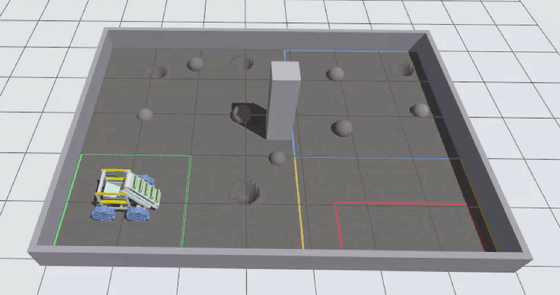
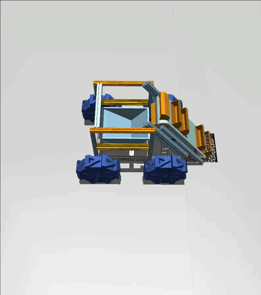

# lunabotics_sim

### Gazebo

[](media/videos/gazebo.webm)

▶ [Full video (GIF above is 3× speed): driving in the Artemis Arena](media/videos/gazebo.webm)

### MuJoCo

[](media/videos/mujuco.webm)

▶ [Full video (GIF above is 3× speed): bucket digging test](media/videos/mujuco.webm)

For how everything works, see [docs/GUIDE.md](docs/GUIDE.md); for what the
simulation can and can't be trusted for, see its section 14.

## Robot hardware

| Component | Qty | Key specs |
|---|---|---|
| Drive gearmotor, StepperOnline 57BLR70-24-02-HG50 | 4 | 24 V, 50:1, 20 N·m continuous, 70 rpm |
| Belt motor, TSINY TS-30GZ6287-R-LS | 1 | 12 V worm gear, 50 rpm, ~6 N·m |
| Lift actuator, Progressive Automations PA-14-6-35 | 2 | 12 V, 6" stroke, 35 lb each, 2"/s |
| Wheels | 4 | Ø361 mm × 100 mm |
| Excavator buckets | 10 | on a 0.65 m belt between two Ø94 mm rollers |
| Total mass | — | 50 kg |

Full parts list: [docs/GUIDE.md section 16](docs/GUIDE.md#16-the-robots-parts).

## Install dependencies

```bash
sudo apt install ros-lyrical-gz-ros2-control ros-lyrical-teleop-twist-keyboard
sudo apt update && sudo apt install --only-upgrade 'ros-lyrical-*'
```

## Build

```bash
cd ~/Desktop/lunabotics_sim
source /opt/ros/lyrical/setup.bash
colcon build --packages-select lunabotics_model
source install/setup.bash
```

## Run

Gazebo simulation:

```bash
ros2 launch lunabotics_model gazebo.launch.py
```

Gazebo simulation rendered on the NVIDIA GPU (hybrid-graphics laptops):

```bash
ros2 launch lunabotics_model gazebo.launch.py gpu:=true
```

Gazebo simulation in the Lunabotics Artemis Arena (BP-1 regolith simulant,
craters, rocks, column; the robot starts in the starting zone):

```bash
ros2 launch lunabotics_model gazebo.launch.py world:=artemis_arena
```

Soft soil instead of a rigid floor (wheels sink and slip in BP-1; runs slower):

```bash
ros2 launch lunabotics_model gazebo.launch.py world:=artemis_arena soil:=bekker
```

Print the soil model's sinkage, slip and wheel forces every 2 s:

```bash
LUNA_TERRA_DEBUG=1 ros2 launch lunabotics_model gazebo.launch.py world:=artemis_arena soil:=bekker
```

Driving on `soil:=bekker`: the robot sits ~24 mm down in the BP-1 (its
wheels look slightly below the floor), accelerates more slowly, cruises
~12% slower than commanded, and turns about two-thirds as far as commanded.

Start somewhere else in the arena (metres from the starting-zone corner, heading in radians):

```bash
ros2 launch lunabotics_model gazebo.launch.py world:=artemis_arena x:=1.5 y:=0.5 yaw:=0.3
```

RViz model viewer (no physics):

```bash
ros2 launch lunabotics_model display.launch.py
```

In RViz, set **Fixed Frame** to `base_link` and add a **RobotModel** display.

## Control

Open a second terminal and run:

```bash
cd ~/Desktop/lunabotics_sim && source install/setup.bash
```

Drive with the keyboard (the robot keeps moving until you press `k`):

```bash
ros2 run teleop_twist_keyboard teleop_twist_keyboard --ros-args -p stamped:=true -p use_sim_time:=true
```

| Key | Action |
|---|---|
| `i` | Forward |
| `,` | Reverse |
| `j` / `l` | Turn left / right |
| `u` / `o` | Forward, curving left / right |
| `m` / `.` | Reverse, curving left / right |
| `k` | Stop |
| `q` / `z` | Increase / decrease speed |

Run the excavator belt in rad/s, up to `5.24` (the motor's 50 rpm; `0.0` to stop):

```bash
ros2 topic pub -w 1 --times 3 /belt_velocity_controller/commands std_msgs/msg/Float64MultiArray "{data: [3.0]}"
```

Lower the ladder (range `-0.152` to `0`, in metres along its rails; `0` is fully raised), then raise it back:

```bash
ros2 topic pub -w 1 --times 3 /excavator_lift_controller/commands std_msgs/msg/Float64MultiArray "{data: [-0.15]}"
ros2 topic pub -w 1 --times 3 /excavator_lift_controller/commands std_msgs/msg/Float64MultiArray "{data: [0.0]}"
```

Watch the motors' live torque (wheels, belt roller) and the lift's force as a table:

```bash
ros2 run lunabotics_model motor_monitor.py
```

Raw values, in the order of the `name` field:

```bash
ros2 topic echo /joint_states --field name
ros2 topic echo /joint_states --field effort
```

## Update the model from Onshape

Export the URDF to `src/lunabotics_model/urdf/assembly_1.urdf` and the meshes to `src/lunabotics_model/meshes/`, then run:

```bash
cd ~/Desktop/lunabotics_sim/src/lunabotics_model
python3 scripts/fix_kinematics.py --input urdf/assembly_1.urdf --output urdf/assembly_1_fixed.urdf
python3 scripts/add_ros2_control.py --input urdf/assembly_1_fixed.urdf --output urdf/assembly_1_sim.urdf
cd ~/Desktop/lunabotics_sim && colcon build --packages-select lunabotics_model
```

## Motor and actuator limits

Set in `src/lunabotics_model/scripts/fix_kinematics.py` (and the drive
controller's top speeds in `config/controllers.yaml`):

| Actuator | Torque / force limit | Speed limit | Source |
|---|---|---|---|
| Wheel motors (×4), `revolute_1*` | **20 N·m** (`WHEEL_EFFORT`) | **7.33 rad/s = 70 rpm** (`WHEEL_VELOCITY`), ≈ 1.3 m/s | 57BLR70-24-02-HG50 datasheet: rated 17.63 N·m at 70 rpm, gearbox 20 N·m continuous / 40 N·m momentary |
| Drive roller (belt), `drive_roller_joint` | **6 N·m** (`ROLLER_EFFORT`) | **5.24 rad/s = 50 rpm** (`ROLLER_VELOCITY`), ≈ 0.25 m/s belt | TSINY TS-30GZ6287-R-LS 12 V worm-gear motor, 50 rpm version (~6 N·m rated, seller listings); assumed direct on the roller |
| Excavator lift, `excavator_lift` | **311 N = 2 × 35 lb** (`LIFT_EFFORT`) | **0.0508 m/s = 2"/s** (`LIFT_VELOCITY`); travel **−0.152 to 0 m** (6" stroke down from the CAD pose) | **two** Progressive Automations PA-14-6-35, one each side, driven together (12 V; 35 lb each; 1.38"/s at full load); assumed pushing straight along the rails, CAD pose = retracted |
| Bucket track joints (×30) | 200 N / N·m (`BUCKET_EFFORT`) | 5 m/s / rad/s (`BUCKET_VELOCITY`) | simulation only (moves the buckets round the belt) |
| Drive controller | — | 1.0 m/s forward, 2.0 rad/s turning | `linear.x.max_velocity`, `angular.z.max_velocity` in `config/controllers.yaml` |

## Change the robot's mass, motor limits or wheel slip

Edit the constants at the top of `src/lunabotics_model/scripts/fix_kinematics.py`
(`TOTAL_MASS`, `ELECTRONICS_MASS`, `BIN_MASS`, `DRIVE_MOTOR_MASS`,
`WHEEL_EFFORT`, `WHEEL_VELOCITY`), then regenerate as in
"Update the model from Onshape" above.

Soft-soil constants (`soil:=bekker`): edit `SOIL` at the top of
`src/lunabotics_model/scripts/bekker_terramechanics.py`, then rebuild.

Wheel slip on the regolith (`soil:=rigid`): edit `SLIP_COMPLIANCE_LONGITUDINAL` and
`SLIP_COMPLIANCE_LATERAL` at the top of
`src/lunabotics_model/scripts/add_ros2_control.py`, then regenerate the same way.

## Change the Artemis Arena layout

Random rocks and craters, as the judges place them (any seed number):

```bash
cd ~/Desktop/lunabotics_sim/src/lunabotics_model
python3 scripts/generate_arena_world.py --output-dir worlds --seed 7
cd ~/Desktop/lunabotics_sim && colcon build --packages-select lunabotics_model
```

Back to the guidebook layout: run the same command without `--seed`.

## MuJoCo bucket digging test

Set up once:

```bash
cd ~/Desktop/lunabotics_sim
uv venv .venv-mujoco
uv pip install --python .venv-mujoco/bin/python mujoco numpy pyyaml
```

Watch the buckets dig:

```bash
.venv-mujoco/bin/python mujoco_dig/dig_test.py --viewer
```

The sim runs at about 0.17× real time. Keep the window open: buckets carry
regolith up the ladder after ~30 s and it reaches the bin after ~1 min; the
full run takes ~3 min, then the window stays open until you close it. Do not
use the NVIDIA offload variables with this viewer.

Viewer controls: left-drag to rotate, right-drag to pan, scroll to zoom,
space to pause.

Run without a window and print the counts:

```bash
.venv-mujoco/bin/python mujoco_dig/dig_test.py
```

Options:

| Option | Default | Meaning |
|---|---|---|
| `--duration` | `30` | seconds of digging |
| `--speed` | `0.15` | belt speed (m/s) |
| `--lift` | `-0.12` | dig depth: ladder position on its rails (m) |
| `--advance` | `0.005` | robot creep speed into the regolith (m/s) |
| `--start-lift` | `0.0` | ladder position before digging starts (m) |
| `--plunge` | `0.05` | speed the ladder is lowered into the regolith (m/s) |
| `--radius` | `0.012` | regolith particle radius (m) |
| `--layers` | `4` | layers of particles in the pit |
